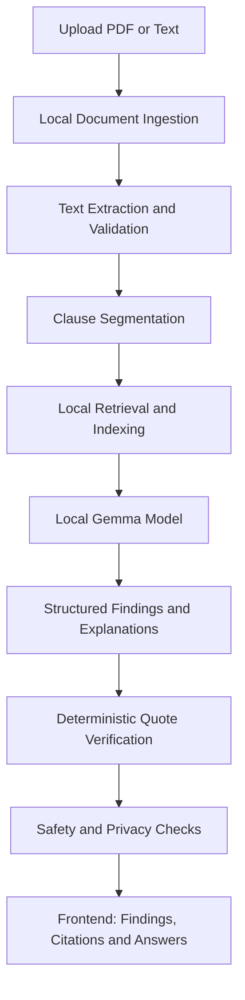

# ClauseGuard — Private, On-Device Legal Document Triage Agent

**Understand your legal documents. Identify important clauses. Keep your data private.**

ClauseGuard is an open-source, privacy-first AI assistant that helps users understand legal documents locally on their own devices. It explains clauses in plain language, highlights obligations and potential risks, and connects its findings to verifiable passages from the original document.

Built for **ZeroDay OSS Hacktoberfest 2026 — Problem Statement 2 (PS2): Agentic AI, Private Legal Document Triage Agent**.

> **Disclaimer:** ClauseGuard is not a lawyer and does not provide legal advice. It helps users understand documents and prepare questions for a qualified legal professional.

---

## Table of Contents

- [Overview](#overview)
- [Problem Statement](#problem-statement)
- [Key Features](#key-features)
- [How It Works](#how-it-works)
- [Technology Stack](#technology-stack)
- [Project Structure](#project-structure)
- [Getting Started](#getting-started)
- [Configuration](#configuration)
- [Privacy and Security](#privacy-and-security)
- [Testing and Evaluation](#testing-and-evaluation)
- [Limitations](#limitations)
- [Roadmap](#roadmap)
- [Contributing](#contributing)
- [License](#license)

---

## Overview

Legal documents often contain complex language, hidden obligations, penalties, deadlines, renewal conditions, and termination clauses. Understanding these details can be difficult for people without a legal background.

Uploading sensitive agreements to cloud-based AI services also raises privacy concerns.

ClauseGuard addresses these challenges with a local document-analysis workflow powered by an on-device Gemma model.

The application is designed to:

- Process PDF and plain-text legal documents locally.
- Explain complicated clauses in understandable language.
- Identify obligations, rights, deadlines, penalties, and potential risks.
- Link findings to exact source passages.
- Distinguish what a document explicitly states from possible interpretations.
- Highlight ambiguous, missing, or jurisdiction-dependent information.
- Encourage professional legal review when appropriate.

### Intended users

- Tenants reviewing residential rental agreements.
- Employees reviewing employment contracts and offer documents.
- Privacy-conscious individuals handling sensitive documents.
- Small business owners reviewing service agreements.
- Developers and researchers exploring private, grounded legal AI systems.

## Problem Statement

Many general-purpose AI assistants can produce plausible but unsupported answers, overlook important clauses, or require sensitive documents to be transmitted to external services.

ClauseGuard is designed around three principles:

1. **Privacy:** Document content and derived information remain on the user's device during normal operation.
2. **Grounding:** Findings should be supported by relevant passages, with quotations verified by deterministic code.
3. **Calibrated explanations:** Uncertainty, missing information, and jurisdictional limitations should be communicated clearly rather than hidden.

## Key Features

### 1. Local document processing

- PDF and plain-text document ingestion.
- Local text extraction and document segmentation.
- Source offsets retained for locating relevant passages.
- Optional local OCR for scanned documents.

### 2. Plain-language explanations

Translate complicated clauses into accessible explanations while preserving the meaning and context of the source text.

### 3. Clause and risk identification

Designed to surface:

- Payment obligations and deposits.
- Deadlines and notice periods.
- Penalties and financial liabilities.
- Termination and renewal conditions.
- Employment bonds and restrictive clauses.
- Potentially important or unclear contractual terms.

These are review signals, not definitive findings of illegality or enforceability.

### 4. Evidence-backed findings

Each supported finding should reference its source passage. Quotes are checked against the original extracted text instead of being accepted solely because the model generated them.

### 5. Document-grounded question answering

Users can ask questions about their document and receive answers based on retrieved passages, with citations and explicit uncertainty where evidence is insufficient.

### 6. Missing information and ambiguity detection

Identify topics that appear unclear, are not addressed in the document, or require additional context.

### 7. Privacy-first architecture

- Local backend bound to `127.0.0.1`.
- Local Gemma inference through a supported local runtime.
- No cloud LLM processing in the intended normal workflow.
- Temporary-file cleanup and sensitive-log filtering.
- No persistent document storage by default.

### 8. Safety controls

- Prompt-injection defenses.
- Structured model outputs.
- Source-quote verification.
- Refusal behavior for requests requiring definitive legal judgments.
- Clear legal disclaimers and escalation to qualified professionals.

> Features described here represent the project's intended design. Verify implementation and test status against the current codebase before claiming every feature is production-ready.

## How It Works



### Processing pipeline

1. **Ingestion:** Read the supported document format and extract text locally.
2. **Segmentation:** Divide the extracted text into clauses or useful passages while preserving source locations.
3. **Retrieval:** Find passages relevant to a requested analysis or user question.
4. **Inference:** Ask the locally running Gemma model to generate structured explanations grounded in the retrieved context.
5. **Verification:** Check quotations and source references against the original extracted text.
6. **Safety validation:** Apply output validation, uncertainty handling, and refusal policies.
7. **Presentation:** Display findings, supporting passages, and limitations in the local frontend.

## Technology Stack

| Component | Technology |
|---|---|
| Frontend | React, TypeScript, Vite |
| Styling | Tailwind CSS or CSS Modules |
| Backend | Python, FastAPI, Uvicorn |
| Model | Gemma 3n or Gemma 4 edge-class variant, subject to availability and compatibility |
| Inference runtime | Ollama or llama.cpp |
| PDF parsing | PyMuPDF or pypdf |
| Retrieval | BM25 and optional local embeddings |
| Vector storage | In-memory FAISS or NumPy-based storage |
| API communication | Local HTTP and Server-Sent Events where implemented |
| Frontend state | Zustand and TanStack Query |
| Document viewer | pdfjs-dist |
| Backend testing | pytest |
| Frontend testing | Vitest and React Testing Library |
| End-to-end testing | Playwright |
| Accessibility testing | axe-core |
| Packaging | Docker Compose and Makefile scripts |

Exact dependency versions and runtime compatibility should be recorded in the project's lockfiles and test documentation.

## Project Structure

The following is the planned repository organization. Keep the actual repository aligned with the approved project plan and update this section if the implementation differs.

```text
ClauseGuard/
├── README.md
├── LICENSE
├── CONTRIBUTING.md
├── SECURITY.md
├── Makefile
├── docker-compose.yml
├── .gitignore
│
├── config/
│   ├── default.yaml
│   └── prompts/
│
├── backend/
│   ├── pyproject.toml
│   ├── requirements.lock.txt
│   └── src/
│       └── clauseguard/
│           ├── main.py
│           ├── api/
│           ├── ingest/
│           ├── segment/
│           ├── index/
│           ├── llm/
│           ├── agent/
│           ├── verify/
│           ├── safety/
│           ├── privacy/
│           └── cli.py
│
├── frontend/
│   ├── package.json
│   ├── package-lock.json
│   ├── vite.config.ts
│   ├── index.html
│   └── src/
│       ├── main.tsx
│       ├── App.tsx
│       ├── api/
│       ├── store/
│       ├── components/
│       ├── pages/
│       ├── hooks/
│       ├── styles/
│       └── a11y/
│
├── scripts/
│   ├── fetch_model.sh
│   ├── fetch_cuad.py
│   ├── run_offline_demo.sh
│   └── monitor_connections.sh
│
├── tests/
│   ├── backend/
│   └── e2e/
│
└── eval/
    └── cuad_clause_eval.py
```

## Getting Started

### Prerequisites

Install the tools required by the actual implementation:

- Git
- Python 3.11 or later
- Node.js and npm
- A supported local model runtime, such as Ollama or llama.cpp
- Sufficient memory and disk space for the selected model and its dependencies

The model's actual hardware requirements depend on its variant, quantization, and runtime.

### 1. Clone the repository

```bash
git clone https://github.com/ZERODAY-2026/Code-Celestials.git
cd Code-Celestials
```

If ClauseGuard is located in a subdirectory of the shared repository, enter that directory before continuing.

### 2. Set up the backend

From the repository root, create and activate a Python virtual environment:

**Windows PowerShell**

```powershell
python -m venv .venv
.\.venv\Scripts\Activate.ps1
```

**Linux or macOS**

```bash
python3 -m venv .venv
source .venv/bin/activate
```

Install dependencies using the dependency files actually provided by the project. For example, if the backend uses `requirements.lock.txt`:

```bash
python -m pip install -r backend/requirements.lock.txt
```

If the project uses `pyproject.toml` instead, follow its documented installation method.

### 3. Set up the frontend

```bash
cd frontend
npm ci
```

Return to the repository root when you need to start the backend.

### 4. Configure the local model

Install and configure a supported local inference runtime.

For an Ollama-based setup, verify that the runtime is installed and running:

```bash
ollama --version
ollama list
```

Download the specific Gemma model variant selected by the project configuration. The exact model identifier must match a variant supported by your installed runtime.

```bash
ollama pull <supported-gemma-model>
```

Replace `<supported-gemma-model>` with the actual model identifier you intend to use. Model names and availability can change, so check the runtime's current model catalog.

Configure the application to use the local inference endpoint. Do not replace the local runtime with a cloud API if you intend to preserve the privacy-first architecture.

### 5. Start the application

Use the commands provided by the implementation. If the backend exposes a standard FastAPI application and the frontend uses Vite, the development commands may resemble the following.

**Backend**

```bash
python -m uvicorn clauseguard.main:app --host 127.0.0.1 --port 8000
```

The Python package must be installed or the source directory configured on `PYTHONPATH` for this command to work.

**Frontend**

Open a second terminal:

```bash
cd frontend
npm run dev
```

Open the local URL printed by Vite in your browser.

> These are example development commands, not verified commands for every repository version. Follow the actual entry points, Makefile targets, and package scripts in your checkout. Keep the backend and model runtime bound to loopback interfaces.

## Configuration

The intended configuration file is:

```text
config/default.yaml
```

It may define:

- Local model and inference-runtime settings.
- Document chunking and retrieval settings.
- Confidence and verification thresholds.
- Supported document types and analysis scope.
- Prompt templates and output constraints.

Use configuration rather than hardcoding runtime settings. Never commit credentials, private documents, downloaded model weights, or other sensitive files.

## Privacy and Security

Privacy is a core design requirement, not an optional feature.

### Data handling principles

- Process private document content locally during normal operation.
- Keep backend and model-runtime connections on loopback interfaces.
- Avoid sending documents, questions, embeddings, or extracted text to cloud services.
- Avoid logging document contents, sensitive questions, or personally identifiable information.
- Use temporary storage only when necessary and clean it up appropriately.
- Keep document data in memory by default unless the user explicitly chooses another supported workflow.
- Validate inputs and model outputs.
- Verify cited quotations against the original text.
- Treat document content as untrusted input, including instructions embedded within documents.

### Security reporting

If you discover a vulnerability, report it privately to the repository maintainers rather than publishing sensitive exploit details immediately. See `SECURITY.md` if available.

### Important privacy qualification

Local processing alone does not prove that no data leaves the device. Validate actual network activity, runtime configuration, logging, dependencies, and telemetry behavior before describing a build as fully offline.

## Testing and Evaluation

ClauseGuard is intended to be tested for functional correctness, evidence grounding, privacy, safety, and usability.

### Test categories

| Category | What to validate |
|---|---|
| Unit tests | Parsing, segmentation, retrieval, schemas, and quote verification |
| Grounding tests | Claims and quotations match document evidence |
| Privacy tests | No unexpected outbound network requests or sensitive logging |
| Safety tests | Prompt injection, unsupported legal conclusions, and refusal behavior |
| Adversarial tests | Malformed files and malicious document instructions |
| Frontend tests | Upload, navigation, findings, citations, and error states |
| End-to-end tests | Complete document-analysis workflows |
| Accessibility tests | Keyboard navigation, focus management, and accessible feedback |

Use the commands supported by the current repository. Common examples include:

```bash
python -m pytest
```

```bash
cd frontend
npm test
```

The frontend test command depends on the scripts defined in `frontend/package.json`.

Record actual test results, model details, configuration, and any known failures. Do not report tests as passing unless they have been executed successfully.

## Limitations

- ClauseGuard does not replace a lawyer or provide definitive legal advice.
- Interpretation may depend on jurisdiction, surrounding facts, and applicable law.
- The initial scope focuses on English-language residential rental agreements and employment contracts.
- Scanned PDFs may require optional local OCR.
- Model quality and performance depend on the selected model, quantization, runtime, and available hardware.
- A missing clause in extracted text may reflect parsing or OCR limitations rather than a genuine omission in the original document.
- Citations establish textual support, not the legal correctness of every interpretation.

## Roadmap

- [ ] Reliable PDF and plain-text ingestion.
- [ ] Clause segmentation with accurate source offsets.
- [ ] Local Gemma inference.
- [ ] Evidence-grounded explanations and deterministic quote verification.
- [ ] Risk, obligation, deadline, and termination analysis.
- [ ] Document-grounded question answering.
- [ ] Missing-topic and uncertainty detection.
- [ ] Prompt-injection and unsafe-output defenses.
- [ ] Privacy and outbound-network verification.
- [ ] Automated backend, frontend, and end-to-end tests.
- [ ] Reproducible offline demonstration.
- [ ] Documentation for setup, evaluation, and security.

Update the checklist as features are implemented and verified.

## Contributing

Contributions are welcome.

1. Fork the repository or create a branch according to your team's workflow.
2. Make a focused change.
3. Add or update relevant tests.
4. Run the applicable checks.
5. Update documentation when behavior or configuration changes.
6. Open a pull request describing the change and its validation results.

Please avoid committing model weights, private legal documents, local environment files, generated datasets, or credentials.

## License

Add the repository's chosen open-source license in `LICENSE` and ensure it matches the project and model dependencies. The project plan proposes Apache-2.0 or MIT; the final choice should be explicit before release.

---

**ClauseGuard — Private by design. Grounded in evidence. Built to help people understand legal documents.**
